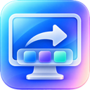

<p align='center'>
  
</p>

<h1 align='center'>AutoDock</h1>

<p align='center'>
  根据外接显示器，自动切换 macOS Dock 位置。<br>
  公司靠右，家里靠左，连接显示器即可切换。
</p>

<p align='center'>
  
  
  <a href='LICENSE'></a>
</p>

AutoDock 是一款轻量的 macOS 菜单栏工具。为不同显示器设置一次规则，之后在公司、家中或移动办公环境之间切换时，Dock 会自动调整到左侧、底部或右侧。

使用 Swift、SwiftUI 和 AppKit 开发，无第三方库依赖。规则保存在本机，无需账号或网络服务。

[功能](#功能) · [安装](#安装) · [快速开始](#快速开始) · [规则说明](#规则说明) · [常见问题](#常见问题) · [开发与发布](#开发与发布)

## 功能

- **按显示器自动切换**：为外接显示器指定 Dock 位置，响应连接、断开、显示配置变化及睡眠唤醒。
- **菜单栏操作**：通过勾选查看当前 Dock 位置和生效规则，随时手动切换；显示器详情在“管理规则…”中查看。
- **多显示器优先级**：同时连接多台显示器时，按规则优先级选择位置。
- **规则管理**：添加、编辑、删除、启用或禁用规则，支持自定义备注名称。
- **断开后的行为**：无外接显示器时，可保持当前位置，或切换到左侧、底部、右侧。
- **登录启动**：通过 macOS 系统登录项启动，显示实际注册及批准状态。
- **本地诊断**：查看最近日志、导出诊断信息，数据损坏时保留原始内容并暂停自动切换。

仅在目标位置与当前位置不同时重新加载 Dock，连续显示器事件会合并处理。

## 安装

### 系统要求

| 项目 | 要求 |
| --- | --- |
| 操作系统 | macOS 13 Ventura 或更新版本 |
| 处理器 | Apple Silicon 或 Intel，安装包包含两种架构 |

最低部署版本及通用架构已在工程中配置，实机验证范围见[发布状态](#发布状态)。

### 下载安装包

1. 打开本仓库的 **Releases**，下载发布版本的 `.dmg` 或 `.zip`。若尚无发布版本，可[从源码运行](#从源码运行)。
2. 打开 DMG 或解压 ZIP，将 `AutoDock.app` 拖入“应用程序”目录。
3. 启动 AutoDock，点击菜单栏中的显示器图标开始使用。

> 当前安装包使用 ad-hoc 签名，尚未进行 Developer ID 签名和 Apple 公证。首次打开可能被 macOS 安全机制阻止，请参考 [Apple 官方说明](https://support.apple.com/guide/mac-help/open-a-mac-app-from-an-unknown-developer-mh40616/mac)操作，无需关闭系统安全检查。

更新时先退出旧版本，再替换“应用程序”中的应用并重新启动。若更新后登录启动失效，可关闭后重新开启，并检查系统批准状态。

## 快速开始

1. **连接显示器**：接入希望配置的外接显示器。
2. **添加规则**：点击菜单栏图标 →“管理规则…”→ 对应显示器的“添加规则…”，选择 Dock 位置并保存。
3. **设置备注**：将规则名称改为“公司显示器”“家里显示器”等，便于识别。
4. **按需调整**：在“设置…”中选择无外接显示器时的行为，并按需开启“登录时启动”。

例如，可以配置为：

| 使用场景 | 配置 | 结果 |
| --- | --- | --- |
| 公司办公 | 公司显示器 → 右侧 | 连接后 Dock 切换到右侧 |
| 家中办公 | 家里显示器 → 左侧 | 连接后 Dock 切换到左侧 |
| 仅使用笔记本 | 无外接显示器 → 底部 | 断开所有外接显示器后，Dock 切换到底部 |

默认开启自动监听、关闭登录启动，无外接显示器时保持当前位置。首次连接显示器不会自动创建规则。

开启登录启动后，若显示等待系统批准，在管理窗口的“设置”页点击“打开系统登录项设置…”，在 macOS 中允许该登录项。

## 规则说明

| 情况 | 处理方式 |
| --- | --- |
| 一条启用的规则命中 | 应用该规则的 Dock 位置 |
| 多条启用的规则命中 | 应用优先级最高的规则，数值越大优先级越高 |
| 最高优先级并列 | 保持当前位置并提示冲突，即使目标位置相同也不自动应用 |
| 外接显示器均未命中规则 | 保持当前位置 |
| 已配置与未配置的显示器同时连接 | 仍应用已配置显示器的规则 |
| 没有外接显示器 | 按“无外接显示器时”的设置处理 |
| 关闭自动监听 | 停止自动应用规则，仍可手动切换 |

新规则的默认优先级为 `0`。同时连接多台已配置显示器时，请为希望生效的规则设置更高优先级。

“快速切换”是临时手动操作。AutoDock 不持续覆盖手动更改，下次显示器变化或修改自动规则时会重新匹配。关闭管理窗口后应用继续在菜单栏运行，使用“退出 AutoDock”结束运行，退出时保留当前 Dock 位置。

### 显示器识别

显示器身份按以下顺序确定：

1. 有效厂商 ID + 型号 ID + 硬件序列号
2. Display UUID
3. 有效厂商 ID + 型号 ID + 真实系统名称

规则与当前显示器分别生成匹配键后进行比较。已有强身份规则不会在强身份暂时缺失时自动降级为名称匹配。自定义备注只用于显示，不影响身份匹配。

- 更换 Hub、端口、连接方式或 DisplayLink 驱动可能改变 UUID，需要重新创建规则。
- 缺少序列号和 UUID 时，厂商、型号与名称组合无法可靠区分两台同型号显示器。
- 镜像输出可能无法取得真实名称，仍会尝试使用序列号或 UUID。
- 不同输出提供相同身份且命中规则时，保持当前位置并提示识别限制。

完整字段与匹配规则见[字段映射文档](docs/FIELD_MAPPING.md)。

## 隐私与权限

- 规则和设置仅保存在当前 Mac 用户的本地偏好中，不使用账号、云同步或网络服务。
- 不请求辅助功能、屏幕录制或定位权限。登录启动由 macOS 系统登录项管理。
- 只修改 Dock 的 `orientation` 偏好，并重新加载 Dock。不修改分辨率、亮度、显示器排列或其他 Dock 设置。
- 诊断导出可能包含显示器序列号、UUID、用户备注和原始本地数据，分享前请检查并移除敏感信息。

## 常见问题

### 为什么没有主窗口或 Dock 图标？

AutoDock 是菜单栏应用，启动后点击顶部菜单栏的显示器图标即可操作。“管理规则…”和“设置…”会打开管理窗口。显示器详情及全部规则在“规则”页查看，登录启动在“设置”页调整，诊断信息在“诊断”页查看和导出。

### 为什么连接显示器后没有切换？

确认“自动监听”已开启，显示器已有启用的规则，且最高优先级没有并列。若目标位置与当前位置相同，应用不会重新加载 Dock。菜单仅显示当前生效规则及错误提示；完整状态可悬停菜单栏图标查看，或打开管理窗口查看。

显示器扫描失败时，不会将其视为“没有外接显示器”。执行失败后，可点击“重试”，或在“诊断”页查看日志。

### 能否指定 Dock 出现在哪台显示器上？

AutoDock 只设置 macOS 定义的左侧、底部或右侧方向，不保证改变 Dock 所在的具体显示器。

### 为什么更换连接方式后规则失效？

显示器的 UUID 可能随端口、Hub 或驱动变化。请查看[显示器识别](#显示器识别)，并为当前连接重新创建规则。

### 如何处理本地数据损坏？

无法解码本地数据时，AutoDock 会暂停自动切换并保留原始内容。先导出诊断备份，再在“设置…”中重置本地规则和设置。重置不会改变系统登录项注册状态。

## 开发与发布

### 从源码运行

1. 安装支持 macOS 13 的 Xcode。
2. 下载或克隆本仓库，打开 `AutoDock.xcodeproj`。
3. 选择共享 Scheme **AutoDock**，运行目标选择本机 Mac。
4. 在 Xcode 中运行，应用图标将出现在菜单栏。

工程默认采用 ad-hoc 签名，无需 Developer ID 证书，未启用 App Sandbox。Bundle ID 为 `com.autodock.AutoDock`，规则通过该应用的 UserDefaults 保存，发布版本应保持此标识不变。

### 打包安装包

本地打包入口：

```bash
bash scripts/package.sh 1.0.0
```

默认输出到 `dist/`：

```text
AutoDock-1.0.0-universal.dmg
AutoDock-1.0.0-universal.zip
AutoDock-1.0.0-SHA256SUMS.txt
```

可通过 `AUTODOCK_OUTPUT_DIR` 指定输出目录，通过 `AUTODOCK_BUILD_NUMBER` 指定整数构建号。脚本构建通用二进制并生成安装包，不启动应用，也不修改打包机器的 Dock 偏好。

### GitHub Actions 发布流程

仓库提供[手动打包工作流](.github/workflows/package.yml)：

1. 在 **Actions** 中选择 **Package AutoDock**，点击 **Run workflow**。
2. 选择分支或标签，填写三段数字版本号，例如 `1.0.0`。
3. 工作流完成后下载产物，包含 DMG、ZIP 和 SHA-256 校验文件。
4. 完成发布验收后，创建对应版本的 GitHub Release，上传安装包及校验文件。

工作流仅手动触发，不执行测试，也不会自动创建 Release。产物保留 14 天。

### 项目结构

```text
AutoDock.xcodeproj/       Xcode 工程和共享 Scheme
AutoDock/
  AutoDockApp.swift       应用入口
  AppDelegate.swift      菜单栏和窗口生命周期
  AppModel.swift         应用状态与自动切换协调
  Models/                显示器身份、规则和设置
  Services/              显示器监听、规则匹配、Dock 操作、存储和登录项
  Views/                 原生菜单和 SwiftUI 管理界面
  Utilities/             日志
AutoDockTests/           核心逻辑单元测试
docs/                    字段映射和历史测试记录
scripts/package.sh       通用安装包脚本
.github/workflows/       手动打包工作流
```

### 发布状态

根据 [2026-10-06 的测试记录](docs/TEST_RESULTS.md)，已完成通用 Release 构建、26 项单元测试、安装包完整性及 ad-hoc 签名检查。界面交互、实际显示器插拔、睡眠唤醒和登录启动仍待验收，Intel Mac 与 macOS 13 尚未完成实机验证。

<details>
<summary>发布前硬件与界面验收清单</summary>

以下项目尚未完成，切换计时以显示器正常完成枚举为前提。

| 编号 | 场景 | 预期 |
| --- | --- | --- |
| A01 | 公司显示器设为右侧，从其他方向插入 | 正常枚举后约 3 秒内切换到右侧 |
| A02 | 家里显示器设为左侧，从其他方向插入 | 正常枚举后约 3 秒内切换到左侧 |
| A03 | 从公司显示器切换到家里显示器 | 不重启应用即可应用新规则 |
| A04 | 分别配置无外接显示器时的四种行为，再断开显示器 | 按对应设置处理 |
| A05 | 单独连接未配置的显示器 | 保持 Dock 位置并提示添加规则 |
| A06 | Dock 已在目标位置时触发显示器事件 | 无需重载 Dock |
| A07 | 连续切换配置或快速插拔 | 合并事件，处理最终有效状态 |
| A08 | 创建规则后退出应用、重启应用及 Mac | 规则和设置保持 |
| A09 | 安装并批准登录启动，重新登录 | 自动启动并匹配规则 |
| A10 | 新增、编辑、禁用及删除规则 | 界面状态与存储一致，关闭窗口不退出 |

额外场景：睡眠唤醒、开合盖、扩展与镜像切换、同型号显示器、USB-C Hub、DisplayLink、更换端口、优先级冲突、手动切换、关闭监听、执行失败及数据恢复。

</details>

## 反馈与贡献

欢迎通过本仓库的 **Issues** 报告问题或提出建议，也欢迎提交 **Pull Request**。

报告问题时，请附上 macOS 版本、Mac 芯片类型、显示器型号与连接方式、复现步骤，以及预期和实际行为。如需提供诊断信息，请先移除序列号、UUID 和个人备注。

## 许可证

本项目采用 [MIT 许可证](LICENSE)。
